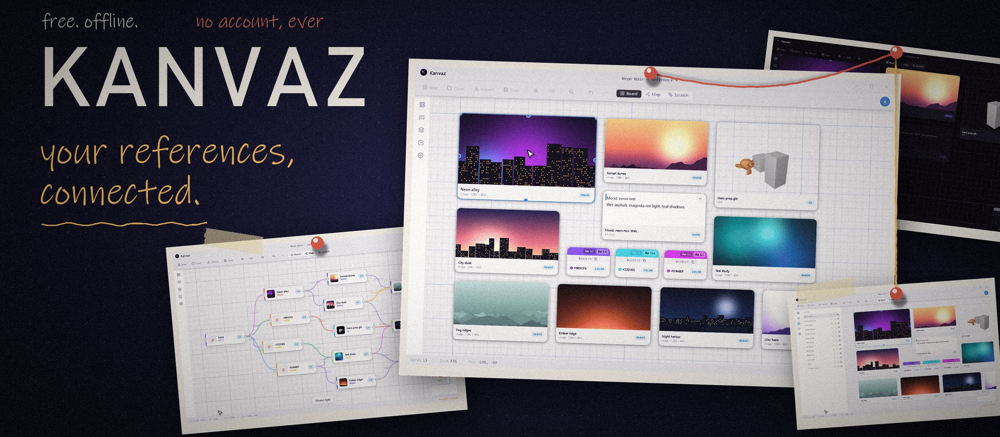
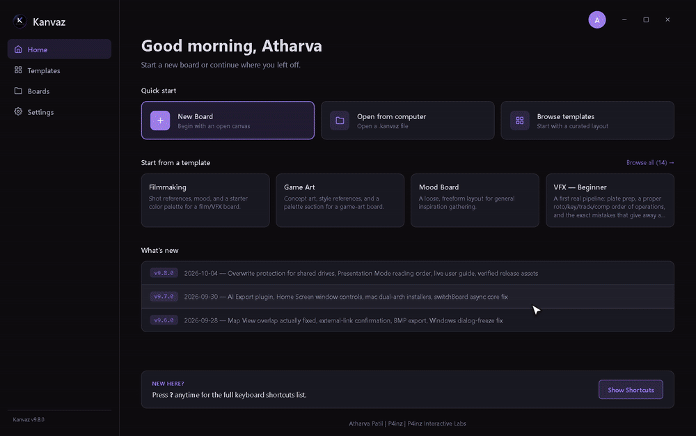
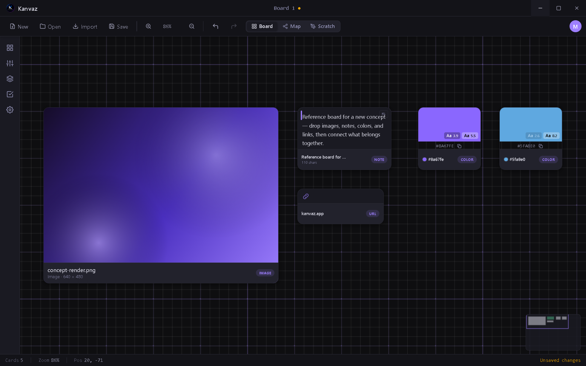
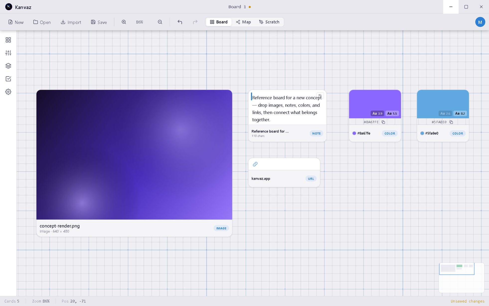
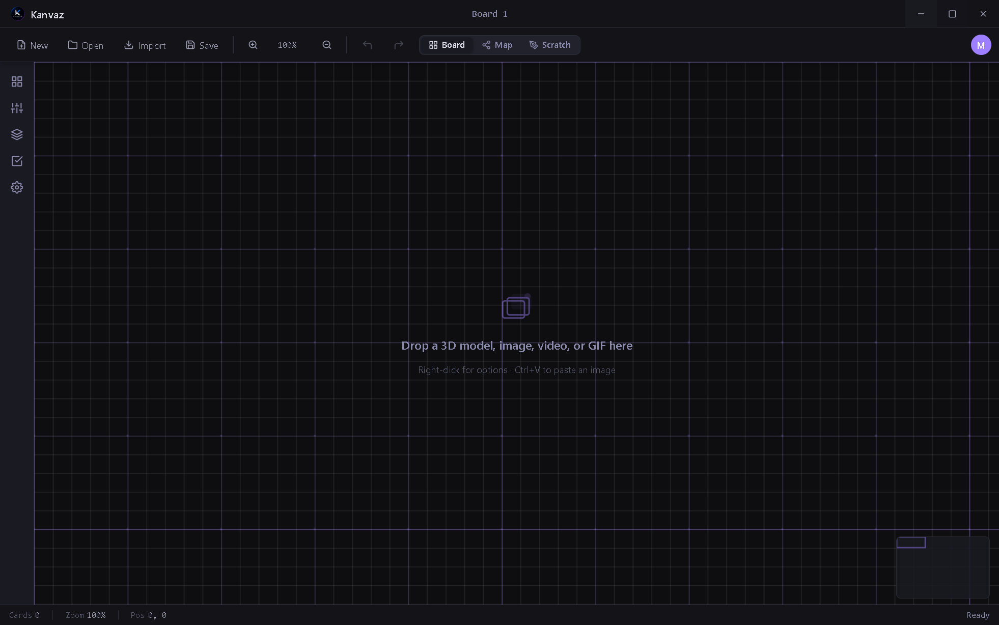
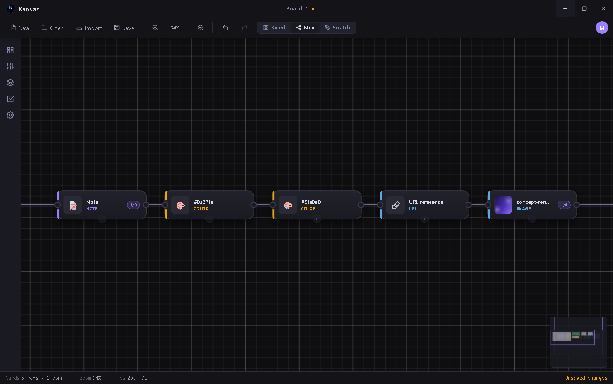
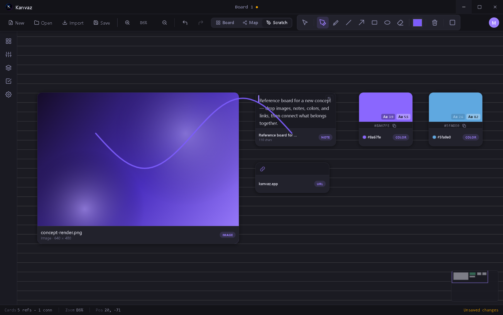
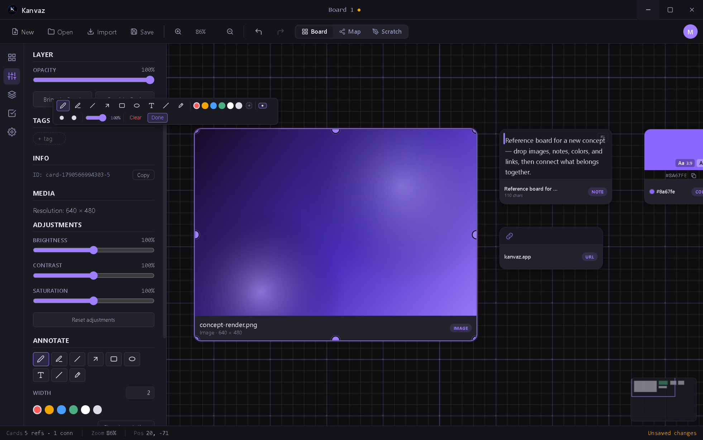
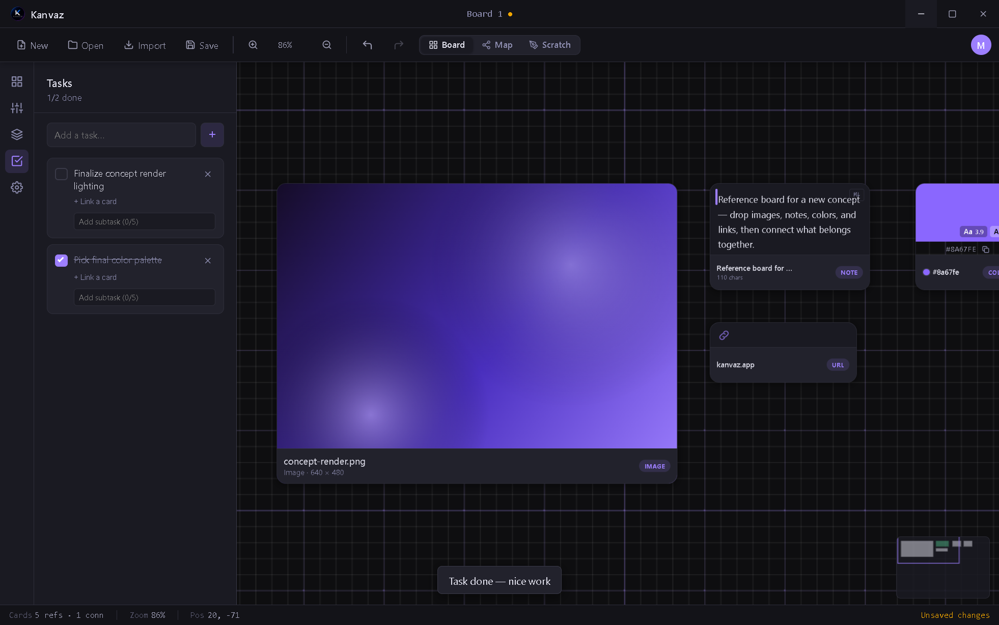
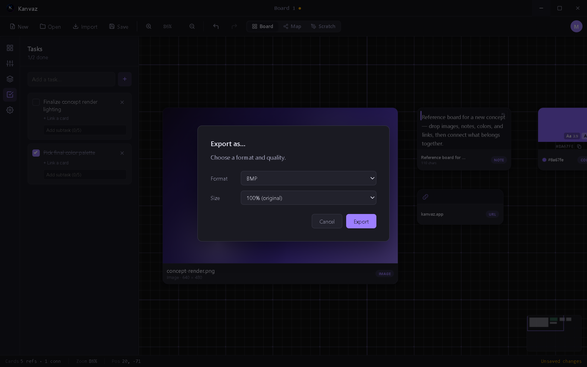

<p align="center">
  
</p>

<p align="center">
  <a href="https://github.com/p4inz-code/kanvaz/releases/latest"></a>
  <a href="https://github.com/p4inz-code/kanvaz/releases/latest"></a>
  <a href="https://github.com/p4inz-code/kanvaz/stargazers"></a>
  <a href="LICENSE"></a>
  
  
</p>

<p align="center">
  <a href="https://github.com/p4inz-code/kanvaz/commits/main"></a>
  <a href="https://github.com/p4inz-code/kanvaz/commits/main"></a>
</p>

<p align="center">
  <a href="https://github.com/p4inz-code/kanvaz/releases/latest"></a>
  <a href="https://p4inz-code.github.io/kanvaz/guide/"></a>
  <a href="https://discord.gg/8UKt8s5FbW"></a>
</p>

<p align="center"></p>

You have fifty browser tabs open, a folder called "refs_final_v2", and no idea which image the client meant. Kanvaz is a free, open-source, fully offline infinite canvas for VFX artists, 3D artists and anyone who collects references, connects ideas and wants to find them again six months later.

Drop in 3D models, images, video, audio, PureRef boards and files. Link references with typed connections and see the whole web as a graph. Share one card across several boards without copying it. Extend Kanvaz with plugins, or write your own and sell it.

There is no account, no cloud and no subscription. The canvas and your files stay on your machine. It is for people who used PureRef and wanted more than static images, and for people who tried a cloud moodboard and did not want an account standing between them and their own files.

<p align="center">
  
  <br><sub>Half dark, half light: Home, a board filling up, live 3D orbit, Properties, then Map View, Layers and the Command Palette.</sub>
</p>

<table>
<tr>
<td width="50%" align="center">
<sub>Dark theme</sub><br><br>

</td>
<td width="50%" align="center">
<sub>Light theme</sub><br><br>

</td>
</tr>
</table>
<p align="center"><sub>Same board in either theme. Press <code>L</code> to switch, no restart needed.</sub></p>

<details>
<summary>More screenshots: Home Screen, Map View, Scratch Board, side panel, export</summary>
<br>

<p align="center">
  
</p>

<p align="center">
  
  <br><sub>Map View shows every card as a node, color-coded by type and wired together with typed connections.</sub>
</p>

<p align="center">
  
  <br><sub>Scratch Board is a drawing layer over your board with a pen, highlighter, shapes and eraser. It shares the same undo history as everything else.</sub>
</p>

<p align="center">
  
  <br><sub>Annotate any card directly. Brush width and color are in Properties.</sub>
</p>

<p align="center">
  
  <br><sub>Task Tracker is a to-do list beside your board, with subtasks and per-task card links.</sub>
</p>

<p align="center">
  
  <br><sub>Export as turns any image, GIF or video card into PNG, JPEG, WEBP or BMP at any scale.</sub>
</p>

</details>

<p align="center">
  <a href="#download-and-install">Download</a> &nbsp;|&nbsp;
  <a href="#what-makes-kanvaz-different">What is different</a> &nbsp;|&nbsp;
  <a href="#how-kanvaz-compares">Compare</a> &nbsp;|&nbsp;
  <a href="#supported-file-formats">File formats</a> &nbsp;|&nbsp;
  <a href="#keyboard-shortcuts">Shortcuts</a> &nbsp;|&nbsp;
  <a href="https://p4inz-code.github.io/kanvaz/guide/">User guide</a> &nbsp;|&nbsp;
  <a href="#build-from-source">Build from source</a>
</p>

<p align="center"></p>

## Download and install

Pick the file for your system from the [latest release](https://github.com/p4inz-code/kanvaz/releases/latest). There is no account, no sign-in and nothing to configure.

| Your system | Download | Notes |
|---|---|---|
| Windows | `Kanvaz-Setup-<version>.exe` | The installer. Adds a Start Menu shortcut, "Open with" registration and auto-update. |
| | `Kanvaz-<version>.exe` | Portable build. Run it from anywhere, nothing is installed. |
| macOS, Apple Silicon (M1 and newer) | `Kanvaz-<version>-arm64.dmg` | Open it and drag Kanvaz into Applications. |
| macOS, Intel | `Kanvaz-<version>.dmg` | Same steps. There is no `-x64` in this name. |
| Linux | `Kanvaz-<version>.AppImage` | `chmod +x` it and run it. |

Not sure which Mac you have? Open the Apple menu and choose About This Mac. An "Apple" chip means Apple Silicon, "Intel" means Intel. Everything else in a release (`.blockmap`, `latest*.yml`, `SHA256SUMS-*.txt`, plugin `.zip` files) is metadata you can ignore.

> Kanvaz is not code-signed, because certificates cost money and this app is free. Windows will probably show "Windows protected your PC": click More info, then Run anyway. On macOS, Gatekeeper says the app "cannot be opened" the first time: right-click (or Control-click) it, choose Open and confirm once. Both warnings are normal for unsigned indie software. To check a download, compare it with the `SHA256SUMS-*.txt` file on the same release.

Your first five minutes: open Kanvaz, choose New Board (or one of 14 starter templates), drag any image, video, 3D model or PDF onto the canvas, and press `?` for every shortcut. The [Quick Start](https://p4inz-code.github.io/kanvaz/guide/quick-start.html) covers the rest, and [Installation and updates](https://p4inz-code.github.io/kanvaz/guide/installation.html) has the details.

<p align="center"></p>

## What makes Kanvaz different

Most reference boards stop at putting images on a canvas. Kanvaz goes further in six places.

1. It previews 3D models you can orbit live, not static thumbnails. Drop in a `.glb`, `.gltf`, `.obj`, `.fbx`, `.stl`, `.ply`, `.vox`, `.usd` or `.usdz` and spin it on the board with Normal, Wireframe or Matcap shading and animation playback with a scrub bar. `.blend` files preview too if Blender is installed. Without it they become a plain file reference instead of failing.
2. Connections have types, and Map View draws them as a graph. There are 7 relationship kinds (Inspired By, Derived From, Used In, Supports and more), laid out like a node editor so you can see the whole web at once. Every bundled template except the freeform Mood Board ships with connections already set up.
3. One card can live on many boards. Share a reference between a Character board and a Lighting board, edit it once, and it updates everywhere. Most tools make you copy the file or lose track of where it lives.
4. An AI can read and edit your board locally, with your permission. The MCP Bridge plugin lets Claude Desktop or Claude Code query and change the active board over local IPC, never the network. Every change can be undone like anything you do by hand.
5. You can sell your own plugin and Kanvaz takes no cut. Plugins add card types, commands or whole themes through a runtime API, and there is no in-app marketplace between you and your buyers.
6. It is offline and stays that way. No account to lose, no subscription that stops working, no telemetry. The only network calls in the app are buttons you click yourself (Check for Updates, Browse Plugins).

It also stays on top of your other apps. Always on top is on by default and re-raises itself over ZBrush, Blender and Photoshop. MoodLock isolates the selection and hides every toolbar so only the reference is left, and you can flip through cards with the arrow keys. See [Always on top, Top Mode and MoodLock](https://p4inz-code.github.io/kanvaz/guide/working-with-other-apps.html).

<p align="center"></p>

## What you get

| | |
|---|---|
| One canvas for everything | 3D models, images, GIFs, video, audio, notes, colors, URLs and file pointers. Arrange them freely and annotate on top. Each file holds several boards, each with its own view state. |
| Shared cards | The same card can sit on more than one board. Edit it on either and the change is there the next time you open the other. |
| Smart Search | On-device fuzzy search with lemmatizing, so "cars" finds "car". Fully offline, off by default, about 4.5 MB, no native dependencies. |
| Annotation tools | Pen, highlighter, line, arrow, rectangle, ellipse, text, pixel measure and an eyedropper that samples real pixel color, with a custom color picker and per-stroke opacity. |
| Connections and Map View | Link any two references with typed, directional relationships and view them as a node-editor graph with bezier cables. |
| Plugins | Add card types, commands, themes or whole features without forking Kanvaz. |
| Offline | No accounts, no telemetry, nothing phones home. Network activity only happens when you click Check for Updates or Browse Plugins. |

<p align="center"></p>

## How Kanvaz compares

PureRef and Refern are both good, actively maintained tools. This is where Kanvaz differs.

| | Kanvaz | PureRef | Refern | Miro |
|---|---|---|---|---|
| Price | Free, MIT | Free | $35 one-time | Subscription; the free tier caps at 3 editable boards |
| Offline, no account | Yes | Yes | Yes | No, cloud only |
| 3D model preview (orbit, live) | Yes, since v7.4.0 | No | No (`.blend`, `.obj` and `.fbx` are not indexed; on their roadmap) | No |
| Typed connections and graph view | Yes, 7 relationship types and Map View | No | No | Generic whiteboard linking, not typed |
| Video and audio playback, PDF preview | Yes | No | Partial | No |
| Plugin API, sell your own plugin | Yes, no marketplace cut | No | No | App marketplace, Miro takes a cut |

Refern is ahead today on hierarchical tags, color-hex search, image-to-image visual similarity search and 14+ search operators. Kanvaz does not match that depth yet, which matters if search is your main use.

Kosmik, a cloud-synced competitor in the same space, shut down in 2026 and told its users to export their data before they lost access. A `.kanvaz` board is a file on your disk. You can read it with or without the app still existing, which is why "no cloud" is a design decision here and not a slogan.

Kanvaz is a side project with no fixed roadmap, driven mostly by feedback. Found a bug or want a feature? [Open an issue](https://github.com/p4inz-code/kanvaz/issues) or email atharva.patil.cg@gmail.com. Both get read. Updates ship most weeks, and the [CHANGELOG](CHANGELOG.md) explains the reasoning behind each one.

<p align="center"></p>

## Features

3D model preview with 13 render modes, PSD, AI and XD previews, image, GIF, video and audio cards, note, text, color, URL and file cards, shared cards across boards, tags and Smart Folders, a Photoshop-style Properties panel, a Layers panel, 14 board templates, an offline multi-profile system, an annotation toolkit plus a Scratch Board layer, 7 typed connection kinds with a Map View node graph, four official plugins (MCP Bridge, AI Export, Template Maker & Manager, Theme Creator), a Command Palette, and more.

[Full feature list](https://p4inz-code.github.io/kanvaz/guide/features.html)

## Workflows by domain

The same canvas, with different starting points: VFX and previz, 3D and look-dev, game development, and handing a pipeline to a team as two portable files (no account, no server).

[Full workflow walkthroughs](https://p4inz-code.github.io/kanvaz/guide/workflows.html)

<p align="center"></p>

## Build from source

<details>
<summary>Requirements, running in development, building installers</summary>

### Requirements

- Node.js 20+ ([nodejs.org](https://nodejs.org)), the version CI builds every release with
- npm 9+

### Run in development

```bash
npm install
npm start
```

### Build installers

Windows (installer and portable):
```bash
npm run build:win
```
Output: `dist/Kanvaz-Setup-9.8.2.exe` and `dist/Kanvaz-9.8.2.exe`

macOS:
```bash
npm run build:mac
```
Output: `dist/Kanvaz-9.8.2-arm64.dmg` (Apple Silicon) and `dist/Kanvaz-9.8.2.dmg` (Intel, no `-x64` suffix because electron-builder only tags the non-default arch). Both come from one command.

Linux:
```bash
npm run build:linux
```
Output: `dist/Kanvaz-9.8.2.AppImage`

</details>

<p align="center"></p>

## Keyboard shortcuts

The essentials. Press `?` in the app for the full, filterable list.

| Key | Action |
|-----|--------|
| Ctrl+K | Command Palette: fuzzy-search any action, shortcut or plugin command |
| Ctrl+S / Ctrl+O | Save / Open board |
| Ctrl+Z / Ctrl+Y | Undo / Redo |
| Ctrl+F or / | Search and filter cards |
| M | Toggle Board and Map view |
| A | Annotate selected card |
| C | Connections inspector |
| Ctrl+Shift+T | Top Mode: always on top, chrome hidden (toggle) |
| Ctrl+Shift+L | MoodLock: isolate the selection and hide every toolbar, leaving just the reference |
| ? | Shortcuts overlay (toggle) |

[Full keyboard shortcuts reference](https://p4inz-code.github.io/kanvaz/guide/shortcuts.html)

<p align="center"></p>

## File format

A `.kanvaz` file is a zip container holding `board.json` and one file per embedded asset, each checked with SHA-256 for corruption. A damaged asset only turns its own card into "missing media" and leaves the rest of the file alone. Older plain-JSON files still open as before, because Kanvaz detects the format itself.

### Supported file formats

"Real preview" means Kanvaz decodes the file and shows its content in the card (an image, a rendered 3D model, an extracted thumbnail), not just a filename and icon. Kanvaz only registers "Open with Kanvaz" for formats it can show something real for. A format with no preview path is not associated at all, so it never becomes a bare placeholder card. Formats without a working preview are listed under Planned below.

| Format | Extensions | Status |
|---|---|---|
| Image | `.jpg` `.jpeg` `.png` `.bmp` `.webp` | Real preview |
| Animated GIF | `.gif` | Real preview (plays inline) |
| Video | `.mp4` `.webm` `.mov` | Real preview (plays inline) |
| Video | `.mkv` `.avi` | Recognized, may not play (Chromium codec limitation) |
| Audio | `.mp3` `.wav` `.ogg` `.m4a` | Real preview (plays inline) |
| 3D model | `.glb` `.gltf` `.obj` `.stl` `.ply` `.vox` `.usd` `.usda` `.usdc` `.usdz` | Real preview, orbit, 13 render modes |
| 3D model | `.fbx` | Real preview, best effort (the most complex and least standardized of the group) |
| 3D model (materials) | `.mtl` (companion to `.obj`) | Detected and applied automatically |
| Blender | `.blend` | Real preview if Blender is installed locally (auto-detected, or chosen once in Settings). Otherwise a labeled file-reference card |
| PDF | `.pdf` | Real preview with scroll, zoom and page navigation (no text selection or search yet) |
| Adobe | `.psd` `.psb` `.ai` `.xd` | Real preview: full flattened image (PSD/PSB), PDF-compatible view (AI), largest rendition (XD) |
| Adobe | `.indd` `.indt` | Recognized, no preview |
| HDR / EXR | `.hdr` `.pic` | Real preview, tone-mapped from real HDR data |
| HDR / EXR | `.exr` | Real preview. NONE and RLE compression only; ZIP, PIZ, PXR24, B44, DWAA and DWAB are refused with a clear reason instead of showing a wrong image |
| Krita | `.kra` | Real preview from the document's own embedded composite |
| Alembic | `.abc` | Not supported. Deliberately deferred because no safe reference implementation exists yet (see [ROADMAP.md](https://github.com/p4inz-code/kanvaz/blob/main/docs/ROADMAP.md)) |
| PureRef | `.pur` | Real import, every card at its saved position and scale |

Planned (no file association yet and no real preview path today, so Kanvaz does not claim to open these until one exists): ZBrush (`.ztl`), Houdini (`.hip`/`.hipnc`), Maya (`.ma`/`.mb`), Cinema 4D (`.c4d`), Clip Studio Paint (`.clip`) and Procreate (`.procreate`). Houdini and Maya are the most likely to follow Blender's pattern of an optional local-install conversion. The others have no realistic path yet. [ROADMAP.md](https://github.com/p4inz-code/kanvaz/blob/main/docs/ROADMAP.md) explains each one.

[File-format internals and full reference](https://p4inz-code.github.io/kanvaz/guide/file-formats.html)

<p align="center"></p>

## Known limitations

Stated plainly. Custom properties are text-only for now. MKV and AVI may not play because of Chromium codec limits, so MP4 or WebM is the safe choice. `.blend` preview needs a local Blender install. PDF preview has no text search yet. The macOS build is not code-signed.

[Full known-limitations list](https://p4inz-code.github.io/kanvaz/guide/known-limitations.html)

## Roadmap

Kanvaz is developed as an ongoing side project with no fixed deadline, driven mostly by real feedback. The living plan is in [docs/ROADMAP.md](docs/ROADMAP.md). As of 9.8.0:

- Select, move and delete an individual annotation stroke (today "Clear annotations" is all or nothing)
- A first-run "Set up your profile" screen and a profile picker on the Start Screen
- Font preview support (HDR/EXR preview already shipped)
- General UI polish, ongoing

<p align="center"></p>

## Documentation

[Read the full user guide](https://p4inz-code.github.io/kanvaz/guide/) for the quick start, every view and panel, MCP Bridge, plugins and troubleshooting.

- [Technical Overview](docs/TECHNICAL_OVERVIEW.md): architecture, module map, build conventions
- [Privacy](PRIVACY.md): what Kanvaz does and does not do with your data
- [Third-Party Notices](THIRD_PARTY_NOTICES.md): licensing for Electron and other bundled components
- [Changelog](CHANGELOG.md): version history

## Related projects

Same author, same engineering approach, nearby problems:

- [3d-ref-skills](https://github.com/p4inz-code/3d-ref-skills)
- [reference-engineering](https://github.com/p4inz-code/reference-engineering): the reference-engineering concept itself, proposed and developed independently of Kanvaz

## License

MIT, free forever.
Made by Atharva Patil | [P4inz](https://github.com/p4inz-code) | P4inz Interactive Labs, Navi Mumbai, India.

<p align="left">
  <a href="https://github.com/p4inz-code"></a>
</p>

---

<!-- SUPPORT-BLOCK:START -->
<div align="center">

### Support my work

I make these tools on my own and keep them free. If one helped you, you can chip in by UPI. Any amount.

<a href="https://p4inz-code.github.io/donate/"></a>

`9321614988@jio`

On your phone? [Open the donation page](https://p4inz-code.github.io/donate/).

Outside India, or prefer a card?

<a href="https://buymeacoffee.com/p4inz"></a>

</div>
<!-- SUPPORT-BLOCK:END -->
