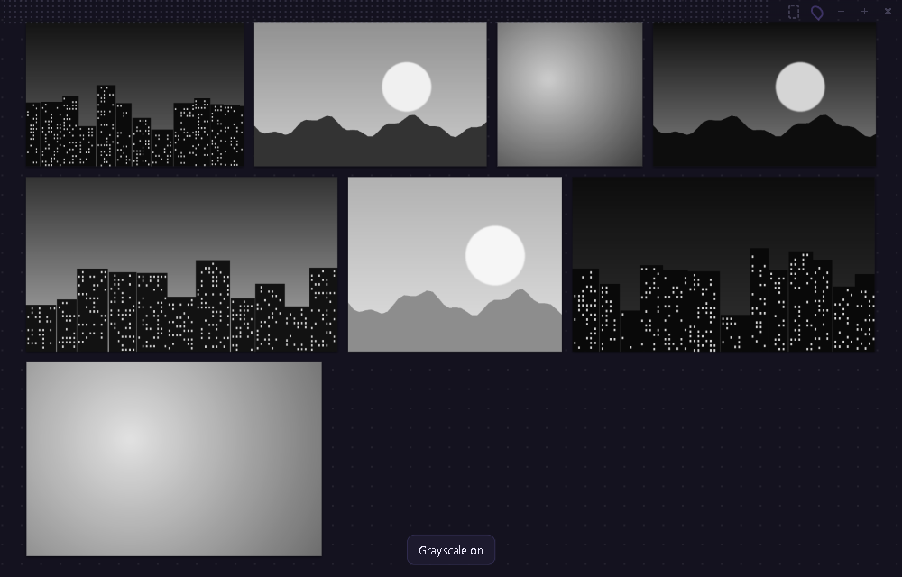

# Kanvaz Mini

*Kanvaz Mini 0.1.0. The first version is built and tested. It will be released as its own app with its own repository, and this page will link to it when it is.*

Kanvaz Mini is a smaller version of Kanvaz for people who want a quick setup. It is a tiny window that stays on top of your work and holds a handful of reference images. You drop images in and carry on drawing. There is nothing to configure and nothing to learn.

## Mini or Kanvaz?

They are two separate apps. Mini is not a mode inside Kanvaz.

| | Kanvaz Mini | Kanvaz |
|---|---|---|
| For | A quick job, three or four pictures beside your canvas | Heavy work: whole projects, big boards |
| Setup | None. It opens straight to a drop zone | A Home Screen with templates to start from |
| Shows | Images and GIFs | Images, video, audio, 3D, PDF, PSD and more |
| Connections, Map View | No | Yes |
| Plugins, tasks, profiles | No | Yes |
| Network | Never | Only when you click an update or catalog button |
| Price | Free, MIT | Free, MIT |

If you outgrow Mini, drag the same images into Kanvaz. Your files stay where they are.

## What it does

- Stays on top and remembers where you put it. The first time it opens in the bottom right corner.
- Takes images and GIFs by drag and drop, paste (`Ctrl+V`) or `Ctrl+O`.
- Moves, scales from a corner, rotates a quarter turn, flips, duplicates and deletes. Undo and redo go back 50 steps.
- `A` arranges everything into a tidy wall of rows. `G` turns images to grayscale for a value check. Both act on the selection, or on everything when nothing is selected.
- A click-through tracing mode (`Ctrl+Alt+T`) lets you draw on the app underneath. Set the window opacity with `Ctrl+[` and `Ctrl+]`.
- Arrow keys step through your references one at a time when nothing is selected.
- Opens PureRef `.pur` boards with each image at its saved position and scale.
- Saves a board as one `.kmini` file with the images inside. Your last session comes back when you reopen the app.

## Quick start

1. Download Kanvaz Mini and run it. The Windows portable file needs no install.
2. Drag images onto it, or press `Ctrl+V` to paste one.
3. Press `A` to tidy them into rows, `F` to fit them in the window, and `P` if you want it to stop floating on top.
4. Press `?` any time for the key list.

## The value check

Press `G` and every image turns grayscale, so you can judge the values without the colors. Press it again to bring the colors back. The images themselves are not changed.

## Tracing mode

Press `Ctrl+Alt+T` and Mini ignores the mouse, so your clicks go to the app underneath. Combine it with `Ctrl+[` to make the window see-through and you can draw straight over a reference. A frame shows around the window while it is on. Press the same keys again, or hover the top bar and click the dashed button, to turn it off.

## Keys

| Key | What it does |
|---|---|
| Drop, `Ctrl+V`, `Ctrl+O` | Add images |
| Drag a card, drag a corner | Move, scale |
| `Shift` + click | Add to the selection |
| Drag on empty space | Select with a box |
| Middle or right drag, or `Space` + drag | Pan |
| Wheel | Zoom |
| `F`, `0`, `+`, `-` | Fit, 100%, zoom in, zoom out |
| `R`, `Shift+R` | Rotate a quarter turn |
| `H`, `V` | Flip left to right, top to bottom |
| `G` | Grayscale on and off |
| `A` | Arrange into rows |
| `Delete` | Remove the selection |
| `Ctrl+Z`, `Ctrl+Y` | Undo, redo |
| `Ctrl+A`, `Ctrl+D`, `Ctrl+N` | Select all, duplicate, new board |
| Arrow keys | Nudge (hold `Shift` for 10 px), or step through references |
| `Ctrl+[`, `Ctrl+]` | Window more or less see-through |
| `P` | Keep on top on or off |
| `Ctrl+Alt+T` | Click-through tracing mode |
| `Ctrl+S` | Save |

## Limits

- Images and GIFs only. Video, audio, 3D, PDF and Adobe files are refused with a short message. Open those in Kanvaz.
- A board stops accepting images at about 250 MB, and holds up to 500 images.
- Windows and Linux are the targets. macOS has not been tested, and the keep-on-top behavior over full-screen apps is unverified there.
- Mini is not code-signed, so Windows SmartScreen warns the first time. Choose More info, then Run anyway.

## Privacy

Mini makes no network requests at all, and the app blocks them. It keeps only its window settings, a recovery copy of your board and a small local crash log. Nothing is uploaded. See [Privacy and your data](privacy-and-your-data.html) for what Kanvaz itself does.

## Related

- [Quick Start](quick-start.html) for full Kanvaz
- [Always on top, Top Mode and MoodLock](working-with-other-apps.html) if you want Kanvaz itself beside your other apps
- [FAQ](faq.html)
- [Contact and support](contact.html)
