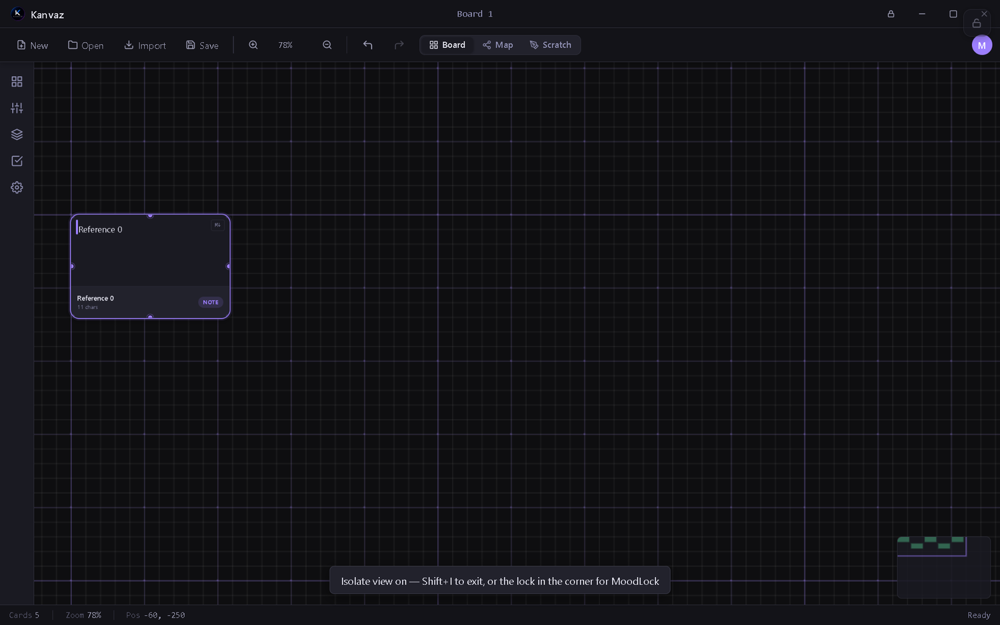
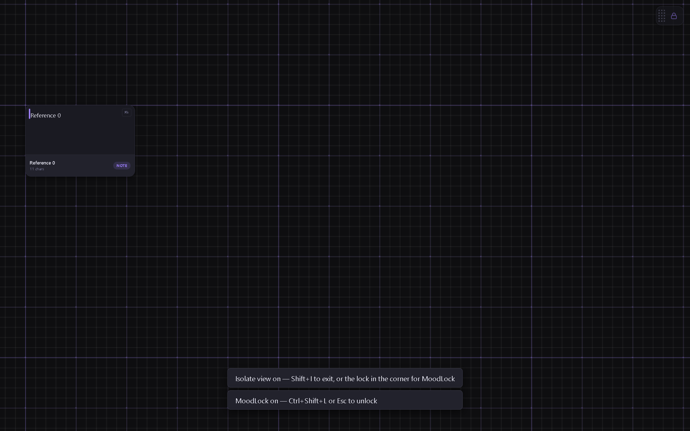
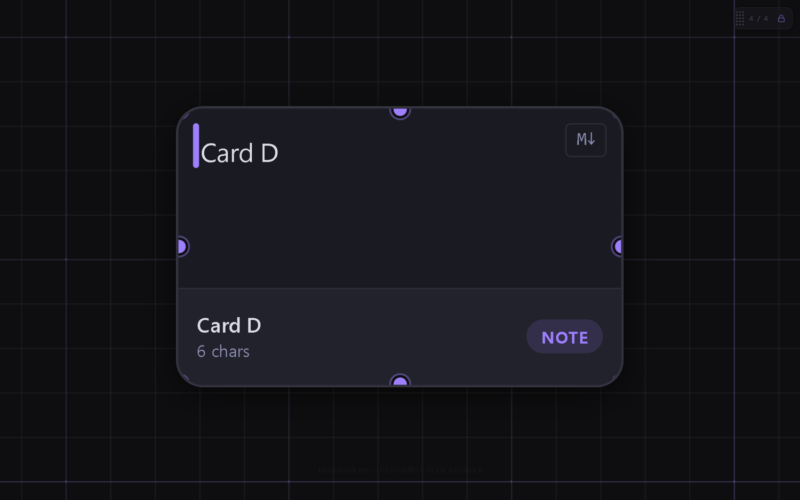
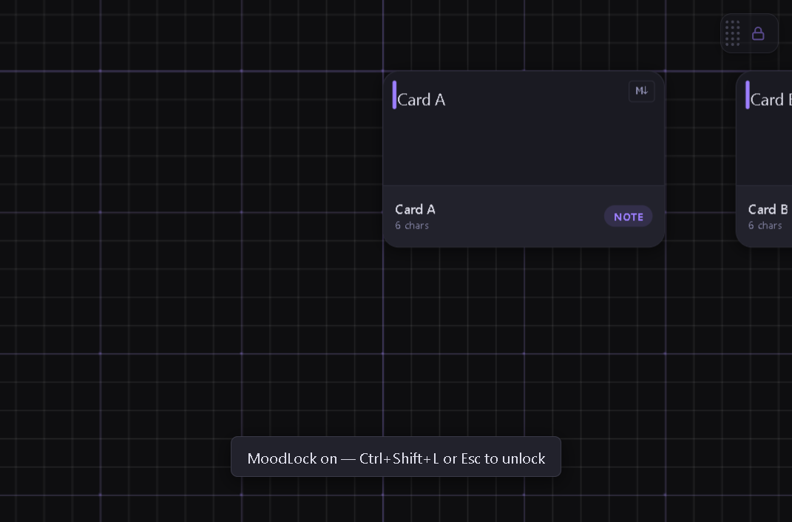

# Always on top, Top Mode & MoodLock

*Verified against Kanvaz v9.8.2.*

Most people use Kanvaz *next to* the program they are actually working in: sculpting in ZBrush, modelling in Blender, painting in Photoshop. Kanvaz has a small family of features for exactly that. This page explains each one, how they differ, and a few setups that work well.

## At a glance

| Feature | What it does | Hides toolbars? | Board read-only? | Shortcut |
|---|---|---|---|---|
| Always on top | Kanvaz stays above your other windows | No | No | Settings, or Command Palette |
| Top Mode | Always on top, plus the toolbar auto-hides and the side panel closes | Auto-hides (hover the top edge) | No | `Ctrl+Shift+T` |
| Isolate View | Shows only the selected cards | No | No | `Shift+I` |
| MoodLock | Isolate + every toolbar and panel gone + always on top | Yes, all of it | Yes | `Ctrl+Shift+L`, or the lock button |
| Presentation Mode | Steps through cards for showing a board to someone | Toolbar and side panel | Yes | Command Palette |

## Always on top

Always on top is on by default. Turn it off in Settings → Canvas & Input → Always on top (default: on), or toggle it from the Command Palette (`Ctrl+K`, then "Toggle Always on Top").

### It works with other apps that also stay on top

<figure class="diagram">
<svg viewBox="0 0 720 300" role="img" aria-labelledby="stk-t stk-d" xmlns="http://www.w3.org/2000/svg">
  <title id="stk-t">How Windows stacks always-on-top windows</title>
  <desc id="stk-d">Three always-on-top windows are stacked by who was raised last. Kanvaz re-raises itself to the top without taking focus. Ordinary windows sit below the whole always-on-top band.</desc>
  <rect x="20" y="16" width="680" height="170" rx="16" fill="var(--accent-bg)" stroke="var(--accent)" stroke-dasharray="6 6"/>
  <text x="38" y="42" font-size="14" font-weight="700" fill="var(--accent)">The always-on-top band (stacked by who was raised last)</text>
  <g font-size="15">
    <rect x="70" y="56" width="420" height="40" rx="10" fill="var(--accent)"/>
    <text x="90" y="82" fill="#fff" font-weight="700">1  Kanvaz  (raises itself twice a second, no focus taken)</text>
    <rect x="46" y="104" width="420" height="34" rx="10" fill="var(--bg-3)" stroke="var(--line)"/>
    <text x="66" y="126" fill="var(--text)">2  ZBrush (raised its own window into the band)</text>
    <rect x="22" y="146" width="420" height="30" rx="10" fill="var(--bg-3)" stroke="var(--line)"/>
    <text x="42" y="166" fill="var(--text-2)">3  Another always-on-top window</text>
  </g>
  <rect x="20" y="204" width="680" height="80" rx="16" fill="var(--bg-2)" stroke="var(--line)"/>
  <text x="38" y="230" font-size="14" font-weight="700" fill="var(--text-2)">Ordinary windows, always below the band</text>
  <text x="38" y="256" font-size="14" fill="var(--text-3)">Browser, file manager, a second monitor's apps...</text>
  <path d="M520 72 L640 72" stroke="var(--accent)" stroke-width="3" marker-end="url(#ar)"/>
  <defs><marker id="ar" markerWidth="8" markerHeight="8" refX="6" refY="4" orient="auto"><path d="M0 0 L8 4 L0 8z" fill="var(--accent)"/></marker></defs>
  <text x="528" y="62" font-size="12" fill="var(--accent)">back to the top</text>
</svg>
<figcaption>Windows stacks every always-on-top window by who was raised last. Kanvaz keeps putting itself back at the top.</figcaption>
</figure>

Some programs (ZBrush is the one that was reported) raise their own window into the same "topmost" layer Kanvaz lives in, and Windows stacks that layer by whichever window was active last. Early versions only set the flag once, so Kanvaz could end up *underneath* and stay there.

Since v9.8.1 Kanvaz keeps itself on top:

- It puts itself back on top without taking focus, so you never lose the app you are typing in.
- It re-checks about twice a second while it is not the focused window.
- It also re-raises immediately after you unlock the screen, resume from sleep, or change or plug in a monitor, because full-screen apps rebuild their windows when that happens.
- If the operating system drops the on-top flag, Kanvaz sets it again.
- On macOS it also floats over full-screen apps.

> The one limit: a program in true *exclusive* full-screen mode (some games) takes over the whole display, and no ordinary window can draw over it. Borderless full-screen windows and apps that merely raise themselves are fine. The macOS full-screen behavior is implemented but has not been tested on a Mac yet.

If Kanvaz still disappears behind something, see [Troubleshooting](troubleshooting.html#kanvaz-goes-behind-another-app).

## Top Mode

Press `Ctrl+Shift+T` for a clean floating-reference view: Kanvaz is forced on top, the toolbar hides until you move the mouse to the top edge, and the side panel closes. Press it again and everything returns exactly as it was. Top Mode is session-only: nothing is written to your settings.

Use it when you want to keep working on the board (move cards, annotate) but with less chrome in the way.

## Isolate View

Select one or more cards and press `Shift+I`. Every other card is hidden, which is handy for focusing on one cluster of a busy board. Press `Shift+I` (or `Esc`) to bring everything back. Nothing is deleted or moved.

## MoodLock

MoodLock is for the moment the reference should be just the picture, parked beside your work, with none of Kanvaz around it.

### Turning it on

<figure class="shot"><figcaption>With Isolate View on, a small lock appears in the corner. Click it to start MoodLock.</figcaption></figure>

Any of these:

- Click the lock button in the titlebar, right next to Minimize.
- Press `Ctrl+Shift+L`.
- While Isolate View is on, click the small lock in the top-right corner.
- Command Palette: "Toggle MoodLock".

What gets isolated depends on what you have selected:

- Cards selected → those cards are isolated, then locked.
- Isolate View already on → what is isolated stays.
- Nothing selected → the whole board is locked.

### What happens while it is on

<figure class="shot"><figcaption>MoodLock on: just the picture, always on top, with a tiny control in the corner.</figcaption></figure>

- The titlebar, toolbar, side panel and rail, status bar and minimap all disappear.
- Kanvaz stays always on top.
- The board is read-only: you cannot drag, resize, delete or rename cards, open context menus, use editing shortcuts, or type into a note's text box.
- The camera still works: mouse wheel, `F` (fit), `0` (reset zoom), `+` and `-`.
- A small control stays in the top-right corner with a drag grip (the titlebar that normally moves the window is hidden) and the lock to turn MoodLock off.

### Flip through your references

<figure class="shot"><figcaption>Left and Right step through the board one card at a time, each one framed to fill the window.</figcaption></figure>

While locked, press Left and Right to show the previous or next card of the board, in reading order (left to right, top to bottom). The corner shows where you are, for example 3 / 12.

- It wraps around at both ends.
- Cards you hid from the Layers panel are skipped.
- Each card is framed to fill the window.
- From the whole board or a multi-card isolation, Right starts at the first card and Left at the last.

### Parking the window

<figure class="shot"><figcaption>Park the small window once. Kanvaz puts it back there next time.</figcaption></figure>

Make the locked window small and drop it in a corner, even on a second monitor. Kanvaz remembers that spot and puts the window back there next time you lock. When you unlock, your normal window returns exactly as it was, including un-maximizing and re-maximizing.

- The very first time, nothing moves.
- If the remembered spot is on a monitor that is no longer connected, it is ignored, so the window can never end up somewhere you cannot reach.
- The locked window can be made smaller than the normal minimum.

### Turning it off

Click the lock in the corner, press `Ctrl+Shift+L`, or press `Esc`. Everything comes back exactly as it was: the always-on-top preference, the side panel if it was open, and your own Isolate View if you had one. After flipping through cards, leaving MoodLock ends the isolation, because the original set was replaced.

MoodLock is session-only. Nothing is written to your board file or settings.

## Presentation Mode

For showing a board to a client or director. From the Command Palette choose Toggle Presentation Mode. The toolbar and side panel are hidden, the board is read-only, and the arrow keys step from card to card. `Esc` exits. The titlebar stays so you can still minimize or close the window.

Presentation Mode, Top Mode and MoodLock are mutually exclusive: starting one leaves the other.

## Setups that work well

Reference beside ZBrush or Blender

1. Build or open your board, select the cards you want.
2. Press `Ctrl+Shift+L`.
3. Shrink the locked window and drag it (by the grip) next to your work. Use Left and Right to flip through references.
4. Unlock with `Esc` when you want to edit the board again.

Second monitor

Park the locked window on the second monitor once. Next time `Ctrl+Shift+L` puts it back there.

Quick glance without locking

Leave Always on top on and use Top Mode (`Ctrl+Shift+T`) when you still need to edit.

## Related

- [Board View](board-view.html): Isolate View, selection and zoom
- [Keyboard Shortcuts](shortcuts.html)
- [Settings](settings.html)
- [Troubleshooting](troubleshooting.html)
